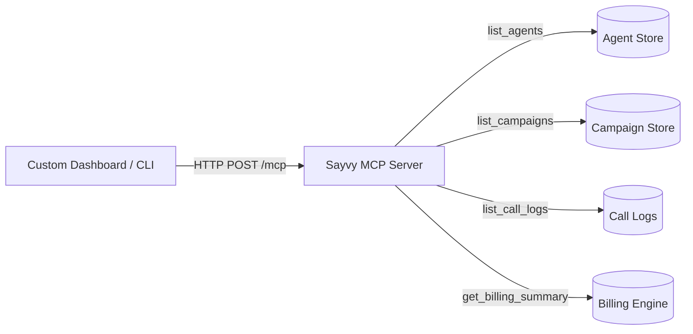

Because the Sayvy AI MCP Server adheres to standard JSON-RPC over Streamable HTTP, you can write lightweight scripts in Python, Node.js, or Go to build custom internal dashboards, terminal monitors (TUI), and automated ops tools without writing custom REST client wrappers.

---

## Architecture Overview



---

## Python Terminal Monitor Example

Here is a standalone Python script using `httpx` to query your Sayvy AI MCP server, fetch active agents, inspect ongoing campaigns, and render a live terminal dashboard.

### 1. Installation

```bash
pip install httpx rich
```

### 2. Dashboard Script (`sayvy_monitor.py`)

```python
import os
import httpx
from rich.console import Console
from rich.table import Table
from rich.panel import Panel

SAYVY_MCP_URL = os.getenv("SAYVY_MCP_URL", "https://api.sayvy.ai/mcp")
SAYVY_API_KEY = os.getenv("SAYVY_API_KEY")

console = Console()

def call_mcp_tool(client: httpx.Client, tool_name: str, arguments: dict = None) -> dict:
    """Execute an MCP tool call over JSON-RPC."""
    payload = {
        "jsonrpc": "2.0",
        "id": 1,
        "method": "tools/call",
        "params": {
            "name": tool_name,
            "arguments": arguments or {}
        }
    }
    response = client.post(
        SAYVY_MCP_URL,
        json=payload,
        headers={"Authorization": f"Bearer {SAYVY_API_KEY}"},
        timeout=10.0
    )
    response.raise_for_status()
    data = response.json()
    return data.get("result", {})

def render_dashboard():
    if not SAYVY_API_KEY:
        console.print("[red]Error: SAYVY_API_KEY environment variable not set.[/red]")
        return

    with httpx.Client() as client:
        # 1. Fetch Agents
        agents_result = call_mcp_tool(client, "list_agents", {"limit": 5})
        agents = agents_result.get("content", [{}])[0].get("text", "[]")

        # 2. Fetch Billing
        billing_result = call_mcp_tool(client, "get_billing_summary")
        billing_text = billing_result.get("content", [{}])[0].get("text", "{}")

        # 3. Fetch Recent Call Logs
        logs_result = call_mcp_tool(client, "list_call_logs", {"limit": 5})
        logs_text = logs_result.get("content", [{}])[0].get("text", "[]")

    console.clear()
    console.print(Panel.fit("[bold cyan]Sayvy AI - Live Workspace Monitor[/bold cyan]", border_style="cyan"))

    # Render Table
    table = Table(title="Recent Activity & Status", expand=True)
    table.add_column("Resource", style="green", no_wrap=True)
    table.add_column("Status / Output", style="white")

    table.add_row("Billing Summary", billing_text[:120] + "...")
    table.add_row("Agents Discovered", f"Tool executed successfully")
    table.add_row("Recent Call Logs", logs_text[:120] + "...")

    console.print(table)

if __name__ == "__main__":
    render_dashboard()
```

### 3. Running the Dashboard

```bash
export SAYVY_API_KEY="your_api_key_here"
python sayvy_monitor.py
```

---

## Node.js / TypeScript Example

If you are integrating Sayvy MCP into a Next.js internal portal or Node.js server:

```typescript
import axios from 'axios';

const SAYVY_URL = 'https://api.sayvy.ai/mcp';
const API_KEY = process.env.SAYVY_API_KEY;

async function executeMcp(toolName: string, args: Record<string, any> = {}) {
  const response = await axios.post(
    SAYVY_URL,
    {
      jsonrpc: '2.0',
      id: Date.now(),
      method: 'tools/call',
      params: {
        name: toolName,
        arguments: args,
      },
    },
    {
      headers: {
        Authorization: `Bearer ${API_KEY}`,
        'Content-Type': 'application/json',
      },
    }
  );

  return response.data.result;
}

// Example: Retrieve all qualified leads
async function checkQualifiedLeads() {
  const result = await executeMcp('list_contacts', {
    lifecycle_stage: 'qualified',
    min_lead_score: 80,
  });
  console.log('Qualified Leads:', result);
}

checkQualifiedLeads();
```

---

## Extending Your Dashboard

Using the full [Tool List](/developers/mcp/tool-list), you can easily extend this dashboard to:
1. Trigger voice test calls directly from an internal UI button.
2. Display a live funnel graph of campaign progress.
3. Automatically alert on Slack or Discord when call logs report high error rates or low satisfaction.
