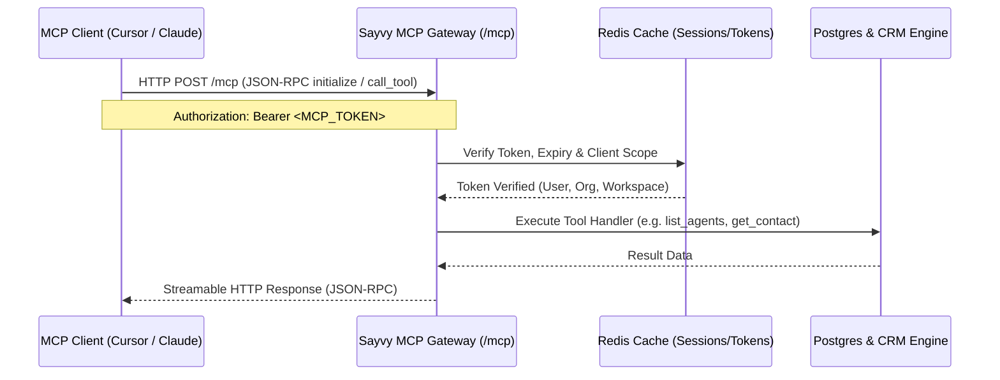

The **Sayvy AI MCP Server** implements Anthropic's open-standard [Model Context Protocol (MCP)](https://modelcontextprotocol.io), exposing your workspace's agents, CRM records, call logs, campaigns, and inbox tools directly to MCP-compatible AI clients such as **Claude Desktop**, **Cursor IDE**, **Windsurf**, and autonomous agent runners.

Rather than switching back and forth between a web dashboard and your IDE, your AI assistant can inspect call transcripts, tune voice agent prompts, launch outbound campaigns, and update CRM records directly from your editor.

<Frame caption="Connect Cursor, Claude Desktop, or Windsurf directly to Sayvy AI">
  
</Frame>

---

## Why Use Sayvy MCP?

* **Conversational Workspace Management:** Ask your coding assistant to `"List all agents in my workspace and show me their system prompts"` or `"Draft an outbound sales campaign for high-value leads"`.
* **Instant Incident & Call Debugging:** Query failed or dropped calls from the last hour, retrieve the exact turn-by-turn transcript, and identify prompt failure modes immediately.
* **Autonomous CRM Upgrades:** Let your agent query qualified contacts, update lifecycle stages, add timestamped notes, and trigger follow-up sequences.
* **Zero Custom Scrapers:** Leverage structured, validated JSON schemas with built-in input validation (`jsonschema Draft 2020-12`) rather than fragile web automation.

---

## Technical Architecture

Sayvy AI's MCP implementation is built using the official Python MCP SDK (v2) and conforms to standard streamable HTTP transport specifications.

### Transport & Endpoints
* **Transport:** Streamable HTTP Session Manager (`StreamableHTTPSessionManager`) with stateless session pooling.
* **Base Endpoint:** `https://api.sayvy.ai/mcp` (or `http://localhost:8000/mcp` for local development).
* **HTTP Methods:** `POST` (Tool calls and JSON-RPC transactions), `GET` (SSE stream subscription & health checks), `DELETE` (Session termination).

### Authentication & Authorization
Sayvy MCP supports two flexible authentication mechanisms:

1. **OAuth 2.0 with PKCE (RFC 7636):**
   * Designed for multi-tenant integrations and desktop clients (Claude Desktop).
   * Fully compliant with OAuth discovery standards:
     * `/.well-known/oauth-authorization-server`
     * `/.well-known/oauth-protected-resource`
   * Endpoints: `/mcp/register` (Dynamic client registration), `/mcp/authorize`, and `/mcp/token`.
2. **Direct Workspace Bearer Tokens:**
   * Ideal for developer IDEs like Cursor and Windsurf.
   * Simply provide your workspace API key in the `Authorization: Bearer <API_KEY>` request header.

<Note>
  All MCP tool invocations are strictly scoped to the active workspace. Sensitive credentials, such as third-party webhook secrets and carrier API keys, are automatically masked in tool outputs.
</Note>

---

## Tool Categories at a Glance

The Sayvy MCP server exposes 25+ native tools categorized across your platform:

| Category | Description | Key Tools |
| :--- | :--- | :--- |
| **Agents** | Inspect, configure, create, and tune voice/chat agents | `list_agents`, `get_agent`, `create_agent`, `update_agent`, `delete_agent` |
| **Contacts & CRM** | Search contacts, update lead scores, and log activity notes | `list_contacts`, `get_contact`, `create_contact`, `update_contact_crm`, `add_contact_note` |
| **Campaigns** | Dispatch and monitor batch outbound voice/text campaigns | `list_campaigns`, `get_campaign`, `create_campaign`, `pause_campaign`, `cancel_campaign` |
| **Call Logs** | Audit call metrics, latency, sentiment, and transcripts | `list_call_logs`, `get_call_log` |
| **Knowledge Base** | Query vector knowledge collections and document sources | `search_knowledge_base`, `list_documents` |
| **Billing** | Monitor plan status, usage credits, and invoices | `get_billing_summary`, `list_invoices`, `get_invoice` |
| **Interactive Chat**| Direct conversational testing with Sayvy AI agents | `sayvy_agent` |

---

## Next Steps

<CardGroup cols={2}>
  <Card title="Quickstart Guide" icon="bolt" href="/developers/mcp/quickstart">
    Connect Cursor, Claude Desktop, or Windsurf in less than 3 minutes.
  </Card>
  <Card title="Complete Tool Reference" icon="rectangle-list" href="/developers/mcp/tool-list">
    Inspect complete JSON schemas, parameters, and return types for all MCP tools.
  </Card>
</CardGroup>
